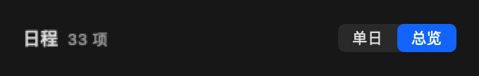

# Event View Modes Implementation Plan

**Goal:** Replace the two simultaneous event lists with one section offering Day and Overview modes.

**Architecture:** Persist the preferred mode in MenuBarPreferences and derive the effective mode from the existing per-view availability flags. CalendarPopoverView places the native segmented picker on the right of the shared header and renders one list below it; RootPopoverView loads only the selected mode. Reuse the existing overview pagination and single-day timeline.

**Tech Stack:** Swift 6, SwiftUI/AppKit, XCTest, existing localization catalog.

## Tasks

1. Add EventListMode and backward-compatible preference decoding, effective-mode fallback, and a SettingsStore setter in the existing settings files.
2. Add the segmented control and one shared header in CalendarPopoverView; simplify UpcomingEventsSection to its scrolling content and connect selection through RootPopoverView.
3. Rename the per-view settings and remove the redundant overview expansion setting; add Chinese/English labels and explanations without discarding existing localization changes.
4. Add targeted tests for persistence and enabled-view fallback, build, run unit tests, and verify the two visual states where automation is available.
5. Document validation and preserve the integration and personal translation backups before updating the original PR branch.

No new source files or dependencies are required. The maintainer has accepted the compact header and authorized updating and merging the original PR.

## Implementation record

- Added `EventListMode` (`day` / `overview`), backward-compatible decoding and persistence, and a fallback to the remaining enabled view.
- Combined both lists under one header and native segmented picker; kept the daily creation button and the overview pagination controls.
- Removed overview-only expansion UI while retaining the stored expansion key for compatibility.
- Changed the settings observer to read preferences after their update, so switching modes starts the matching query. Invalidated pending daily responses when leaving that view.
- Added Chinese/English mode and settings labels, preserving all original localization entries and local UI-test changes.
- The four relevant unit-test suites executed 126 tests with zero failures.
- Added a UI regression for list exclusivity, switching in both directions, and restoring Overview after relaunch. It uses an isolated UserDefaults suite and unavailable data sources, and is configured to retain screenshots when the test can run.
- UI automation could not execute: the macOS test runner stalled before connecting to XCTest. The runner initially failed signature validation; signing only the temporary runner made that validation pass, but the retry still exited before bootstrapping. No UI assertion ran and no automated UI screenshots were produced. The maintainer subsequently accepted the UI after local testing and header refinement.
- Final unit regression executed 444 tests: 443 passed, with only the pre-existing `BoardSnapshotTests.testGroupingByPriorityOrdersHighMediumLowNoneAndSkipsEmptyGroups` failure caused by hard-coded Chinese labels in an English environment. All three new mode tests passed.
- Final `xcodebuild build` succeeded. The original PR branch includes the resolved integration with the reminders board.

## Compact header refinement

- Moved the native small segmented picker into the right side of the event header, removing its separate row.
- Grouped the title and secondary count on the left, with baseline alignment and monospaced digits. The daily creation button follows that group, leaving the picker anchored to the right in both modes.
- Kept intrinsic control sizing for Chinese/English labels and the existing accessibility identifier and mode callbacks.
- Protected the title from truncation and added a compact progress count when space is limited; hover help and accessibility retain the full count description.
- Verified the extracted production header with native NSHostingView rendering at the popover's 340 pt width, including Chinese/English, light/dark, loading, long progress text, and single-mode cases. The header stayed 22 pt tall in all 14 previews. This checks layout only; it does not replace live popover interaction testing.
- The final build succeeded after the header refinement. No additional unit tests were added for this layout change.

Native header layout previews (generated from the production header; these are not full popover screenshots):

